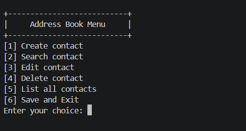
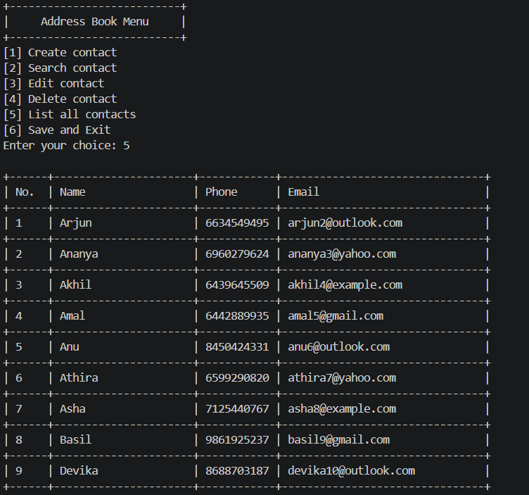

# Address Book Management System

   

A command-line **Address Book Management System built with C**. It allows users to create, search, edit, delete, and display contacts through a simple menu-driven interface. Contact information is stored in a CSV file so it can be loaded again when the program starts.

## Features

- Create contacts with a name, phone number, and email address.
- Search for contacts by name, phone number, or email address.
- Edit existing contact details.
- Delete contacts.
- Display all saved contacts in a formatted table.
- Validate user input and check for duplicate phone numbers and email addresses.
- Load contacts from and save contacts to `addressBook.csv`.

## Input Validation

- Names must begin with an alphabetic character.
- Phone numbers must contain exactly 10 digits and start with a digit from `6` to `9`.
- Email addresses are converted to lowercase, must begin with an alphabetic character, and must end in `.com`.
- Phone numbers and email addresses must be unique.

## Screenshots

### Main Menu



### Contact List



## Project Structure

```text
AddressBook/
├── main.c              # Application entry point and main menu
├── contact.c           # Create, search, edit, delete, and list contacts
├── contact.h           # Contact structures and declarations
├── utils.c             # Input validation and helper functions
├── utils.h             # Utility function declarations
├── file.c              # CSV file loading and saving
├── file.h              # File-handling declarations
├── addressBook.csv     # Contact data
├── tests/
│   └── test_utils.c    # Unit tests
├── .github/
│   └── workflows/
│       └── build.yml   # GitHub Actions CI workflow
└── screenshots/        # Project interface screenshots
```

## Requirements

- GCC compiler (or another C compiler)
- Terminal or command prompt

## Build and Run

Clone the repository:

```bash
git clone https://github.com/adwaithjayan/AddressBook.git
cd AddressBook
```

### Linux

Compile:

```bash
gcc -Wall -Wextra -std=c11 main.c contact.c utils.c file.c -o addressbook
```

Run:

```bash
./addressbook
```

### Windows

Compile:

```bash
gcc -Wall -Wextra -std=c11 main.c contact.c utils.c file.c -o addressbook.exe
```

Run:

```bash
.\addressbook.exe
```

> Run the program from the project directory so it can access `addressBook.csv`. Select **Save and Exit** from the menu to save the contact data.

## Data Storage

Contacts are stored in `addressBook.csv`. The application loads the saved contacts when it starts and writes the contact data back to the file when you choose **Save and Exit**.

## Concepts Used

- Structures and arrays
- Functions and modular programming
- String handling
- Input validation
- Searching, editing, and deleting records
- File handling using standard C file I/O

## Testing

The project includes automated unit tests for input validation and duplicate checking.

Tests are executed automatically through GitHub Actions on both Windows and Linux.

## Downloads

Download the latest version from GitHub Releases.

**Latest Release: [v1.0.0](https://github.com/adwaithjayan/AddressBook/releases/tag/v1.0.0)**

| Platform | Download |
|---|---|
| Windows | [Download executable](https://github.com/adwaithjayan/AddressBook/releases/latest) |
| Linux | [Download executable](https://github.com/adwaithjayan/AddressBook/releases/latest) |

For source code and previous versions, visit the [Releases page](https://github.com/adwaithjayan/AddressBook/releases).

## Author

**Adwaith jayan**